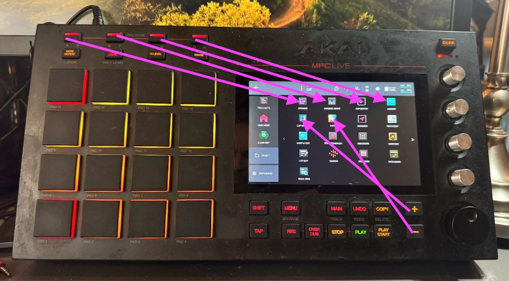

# akai_standalone_remap



Remap the hardware buttons of standalone Akai MPC / Force devices: open any screen from any button,
add double taps, long presses and Shift layers. Tested on a first-generation MPC Live (Hakai,
MPC 3.9.1) and an Akai Force (stock firmware 3.9.0).

The devices have no setting for this, so `hwremap.so` is an `LD_PRELOAD` shim that sits between
the controller and the MPC/Force app. It rewrites the controller's MIDI stream: a press of a chosen
button is swallowed and replaced with other buttons, pads or a touchscreen tap. To the app this
looks exactly like you did it yourself.

The main trick on MPC: holding **Menu** and tapping a pad opens the icon in that cell of the 4×4
Mode Menu. So any button can open any screen: put the icon in the menu cell and map the button to
"Menu + that pad".

## Configs

| File                  | Device   | What it does |
|-----------------------|----------|--------------|
| `configs/mpc-live.conf` | MPC Live | Pad Bank A–D open the top row of the Mode Menu; `+`, `−` and their double taps open the second row |
| `configs/force.conf`    | Force    | Mixer ×2 = Master; Menu ×2 = Main Mode; Knobs: short = Shift + Knobs, long = Knobs, double = original long press |

Install one of them as `/sdcard/hwremap.conf` on the device.

### MPC Live

| Button        | Opens (Mode Menu cell) |
|---------------|------------------------|
| Pad Bank A–D  | top row, icons 1–4     |
| `+`           | second row, icon 1     |
| `+` twice     | second row, icon 3     |
| `−`           | second row, icon 2     |
| `−` twice     | second row, icon 4     |

Rearrange the icons in the Mode Menu to choose what each button opens; it applies right away.
Hold **Shift** for the original function (Shift + `+`/`−` changes values). Pad banks are not
reachable while the remap is on.

### Force

| Button         | Does |
|----------------|------|
| Mixer twice    | Master (the first press opens the mixer as usual) |
| Menu twice     | taps the Main Mode icon in the menu |
| Knobs short    | Shift + Knobs |
| Knobs long     | a plain Knobs press |
| Knobs twice    | the original long press: Knobs held while you hold the button, at least 0.8 s |
| Shift + Knobs  | plain Knobs |

The Main Mode tap uses screen coordinates from `configs/force.conf`. If the icon moves, record a
new tap (see "Touch coordinates").

## How it works

- The shim hooks `snd_rawmidi_open` and `snd_rawmidi_read` and only touches the controller input
  port whose name contains "Private". Every other MIDI port passes through untouched.
- Buttons arrive as notes on channel 1: press is `90 nn 7F`, release is `90 nn 00`. Pads are notes
  on channel 10. The shim parses the stream properly, including running status, SysEx and realtime
  bytes, and replaces only the mapped button notes.
- Injected releases use note-on with velocity 0, like the hardware does. The app ignores note-off for
  buttons: a Menu "released" with `80 7B ..` stays held, and then tapping an icon in the menu opens it
  instead of letting you drag it.
- Long presses, delayed taps and minimum holds fire from timers, when no MIDI is arriving. The app
  reads MIDI from a thread that waits in `poll()`, so the shim also hooks `poll()`: it adds a wake
  pipe and reports the controller port readable while injected bytes are queued.
- Touch taps are written to the touchscreen input device (`/dev/input/event0`) as a multitouch
  down/up, the same events a finger produces.
- The config is re-read whenever its modification time changes, so edits apply on the next button
  press.

## Config reference

File: `/sdcard/hwremap.conf`. One rule per line; `#` starts a comment. Buttons are given by note
number, decimal or `0x` hex.

```
log 1                    log every input byte to /tmp/hwremap.log (keep 0 normally)
hold 49                  while this button (Shift) is held, remapped buttons pass through...
held 1 u49 b1 d49        ...unless a "held" rule exists for them: then it runs instead
combo 2 95 t10,20      while button 2 is held, pressing 95 runs this (any number of hold buttons,
                         up to 32 combo rules); the held button itself still goes through

54 d123 p0x30 u123       on press of 54: Menu down, tap pad 0x30, Menu up
dbl 54 d123 p0x2D u123   second press within dblms runs this instead
dbl 11 b5                with no plain rule, the first press passes through unchanged

tap 1 d49 b1 u49         short press: runs on release
long 1 b1                held past longms: runs at the threshold
                         (without a long rule, the button itself goes through, held)
dbl 1 h1                 with a tap rule: a second press within dblms runs this; the short
                         press waits out the window so it does not fire first

dblms 350                double-tap window, ms
longms 400               long-press threshold, ms
holdms 800               minimum hold for hN, ms
touchms 150              delay before a touch tap, ms
```

Action tokens:

| Token    | Meaning |
|----------|---------|
| `dN`     | button N down |
| `uN`     | button N up |
| `bN`     | button N tap (down + up) |
| `pN`     | pad tap, N is the pad note |
| `hN`     | hold button N down while the source button is held (at least `holdms`) |
| `tX,Y`   | touchscreen tap at raw touch coordinates X,Y |
| `xHH`    | raw MIDI byte |
| `mName`  | MPC: Menu + the pad under mode "Name" (underscores = spaces), looked up in `MPC.settings` |

With a plain rule plus a `dbl` rule, the first press still runs the plain action right away, so a
double tap briefly shows the first screen before the second one.

`mName` reads the Mode Menu layout from `/media/az01-internal/Settings/MPC/MPC.settings`. The app
writes that file only when it saves preferences or quits, so a moved icon is picked up only after
that. Only the 16 cells reachable with Menu + pad work (`ModeMenuPage1Slot0..15`). Fixed
`d123 pN u123` rules do not have this delay.

### Notes

MPC Live buttons (channel 1):

| Button   | Note | Button     | Note |
|----------|------|------------|------|
| Shift    | 49   | `+`        | 54   |
| Menu     | 123  | `−`        | 55   |
| Main     | 52   | Pad Bank A | 35   |
| Next Seq | 42   | Pad Bank B | 36   |
|          |      | Pad Bank C | 37   |
|          |      | Pad Bank D | 38   |

MPC X buttons that MPC Live also accepts: XYFX 126, Channel Mixer 116, Pad Mixer 115.

MPC pads (channel 10), laid out like the hardware. With Menu held, each pad opens the icon in the
same position of the Mode Menu:

```
pad 13: 0x31   pad 14: 0x37   pad 15: 0x33   pad 16: 0x35    <- menu row 1
pad  9: 0x30   pad 10: 0x2F   pad 11: 0x2D   pad 12: 0x2B    <- menu row 2
pad  5: 0x28   pad  6: 0x26   pad  7: 0x2E   pad  8: 0x2C    <- menu row 3
pad  1: 0x25   pad  2: 0x24   pad  3: 0x2A   pad  4: 0x52    <- menu row 4
```

Force buttons (channel 1): Navigate 0, Knobs 1, Menu 2, Matrix 3, Note 4, Master 5, Clip 9,
Mixer 11, Shift 49. More in [TheKikGen's tables](https://github.com/TheKikGen/MPCLiveXplore-libs) (`tkgl_midimapper.h`).

To find the note of any button, set `log 1`, press it, and read `/tmp/hwremap.log`.

### Touch coordinates

Record a tap while touching the target on screen, then decode it:

```sh
ssh root@<device> 'cat /dev/input/event0 > /tmp/touch.bin'   # tap the target, then Ctrl-C
scp root@<device>:/tmp/touch.bin .
python3 -c "
import struct; d=open('touch.bin','rb').read()
for i in range(0,len(d)-15,16):
    s,us,t,c,v=struct.unpack('<IIHHi',d[i:i+16])
    if t==3 and c in (0x35,0x36): print('xy'[c-0x35], v)"
```

## Build

Cross-compile for the device (armhf, glibc 2.39) and run the host tests (ASan/UBSan), both in
Docker:

```sh
./build.sh          # -> hwremap.so
./build.sh test
```

## Install

Over SSH as root. Config changes need no restart; a new `hwremap.so` needs an app restart
(`systemctl restart acvs`), which closes the open project.

### MPC (Hakai)

The root filesystem is read-only, and BusyBox has no `install`.

```sh
scp hwremap.so root@<mpc>:/tmp/hwremap.so.new
scp configs/mpc-live.conf root@<mpc>:/sdcard/hwremap.conf.new

ssh root@<mpc>
mv /sdcard/hwremap.conf.new /sdcard/hwremap.conf
systemctl stop acvs
mount -o remount,rw /
cp /tmp/hwremap.so.new /usr/lib/hwremap.so.new && chmod 755 /usr/lib/hwremap.so.new
mv /usr/lib/hwremap.so.new /usr/lib/hwremap.so
```

First install only: append `/usr/lib/hwremap.so` to every `LD_PRELOAD` line of the launcher,
keeping a backup:

```sh
cp /usr/bin/az01-launch-MPC /usr/bin/az01-launch-MPC.orig-hwremap
sed -i 's#customBufferSizeMPC.so \$CURSOR_SO#customBufferSizeMPC.so /usr/lib/hwremap.so $CURSOR_SO#' /usr/bin/az01-launch-MPC
grep LD_PRELOAD /usr/bin/az01-launch-MPC
```

Then:

```sh
sync; mount -o remount,ro /
systemctl start acvs
grep -c hwremap /proc/$(pidof MPC)/maps  # non-zero = loaded
```

### Force (stock firmware)

No root filesystem changes: the library lives in `/data` and a systemd drop-in adds it to the app's
`LD_PRELOAD` (`/etc` is a writable overlay). Keep whatever `acvs.service` already preloads; on the
tested Force that is `/usr/lib/libforce_cursor.so`
(check with `systemctl show acvs -p Environment`).

```sh
scp hwremap.so root@<force>:/tmp/hwremap.so.new
scp configs/force.conf root@<force>:/sdcard/hwremap.conf.new

ssh root@<force>
mkdir -p /data/hwremap /etc/systemd/system/acvs.service.d
mv /tmp/hwremap.so.new /data/hwremap/hwremap.so && chmod 755 /data/hwremap/hwremap.so
mv /sdcard/hwremap.conf.new /sdcard/hwremap.conf
printf '[Service]\nEnvironment="LD_PRELOAD=/usr/lib/libforce_cursor.so /data/hwremap/hwremap.so"\n' \
  > /etc/systemd/system/acvs.service.d/hwremap.conf
systemctl daemon-reload
systemctl restart acvs
grep -c hwremap /proc/$(pidof MPC)/maps  # non-zero = loaded
```

## Uninstall

MPC:

```sh
systemctl stop acvs
mount -o remount,rw /
cp /usr/bin/az01-launch-MPC.orig-hwremap /usr/bin/az01-launch-MPC
rm /usr/lib/hwremap.so
sync; mount -o remount,ro /
systemctl start acvs
```

Force:

```sh
rm /etc/systemd/system/acvs.service.d/hwremap.conf
systemctl daemon-reload
systemctl restart acvs
rm -r /data/hwremap
```

To disable remapping without uninstalling, empty `/sdcard/hwremap.conf`: with no rules the shim
passes everything through.

## Limitations

- On MPC Live no MIDI note opens Clip Matrix or Clip Editor directly. Newer-model buttons like
  Matrix are not accepted by its firmware, so those screens are reached through the Mode Menu.
- On MPC Live, injected Shift + Next Seq opened Next Sequence rather than the Shift function. On
  Force, injected Shift + Knobs is used by `configs/force.conf`.
- Nothing tells the shim which screen is showing, so a mapping cannot toggle between two screens.
- Touch taps use fixed coordinates; they break if the target moves on screen.
- The Lua `--script` option does nothing in the release MPC build.
